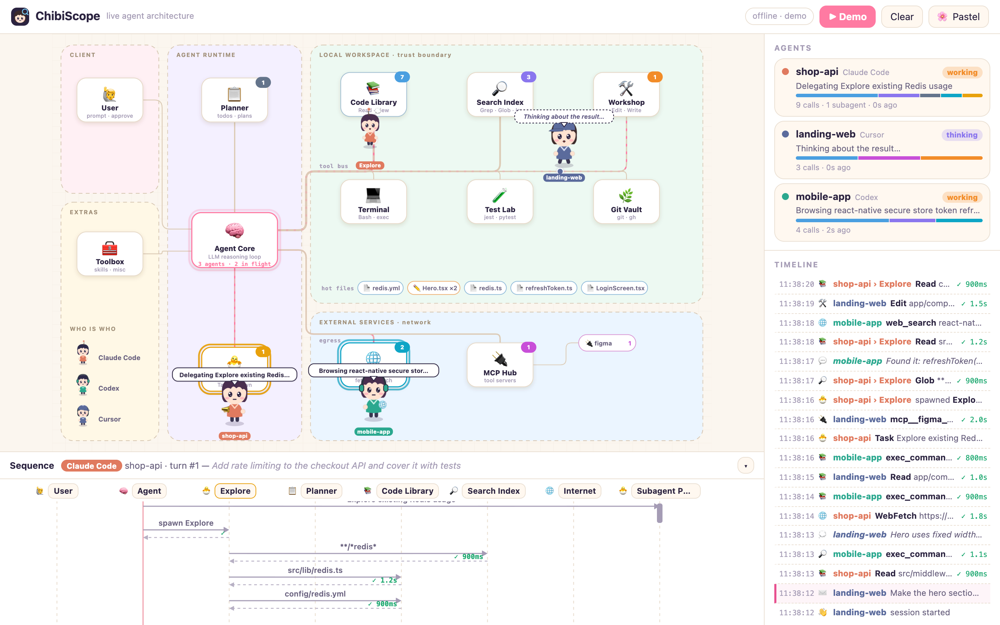
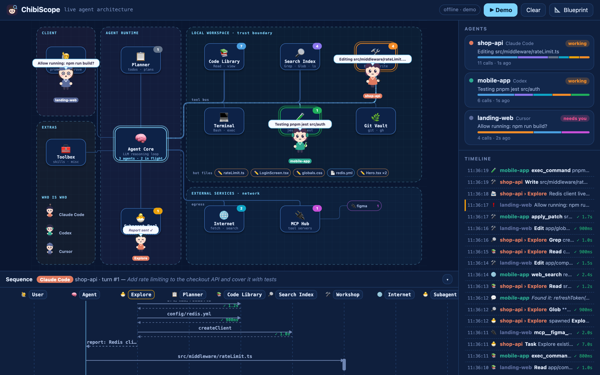

# ChibiScope 🐣🔭

**Watch your AI coding agents work, live.** Every agent becomes a chibi that walks a
system-architecture map: to the *Code Library* when it reads, the *Workshop* when it edits,
the *Test Lab* when it runs tests, out through the *egress* bus to the *Internet* or an MCP
server, and back to the *Agent Core* to think. Subagents hatch as mini chibis. Underneath, a live
UML sequence diagram shows the current turn the way an architect would draw it.

Works with **Claude Code**, **Cursor** and **Codex** (CLI, IDE extension and Desktop), and with any
other agent that can POST a JSON event.

| Pastel | Blueprint |
| --- | --- |
|  |  |

## What you see

- **Architecture map**: trust boundaries (Client, Agent Runtime, Local Workspace, External Services),
  service nodes with call counters, and an orthogonal *tool bus* whose lines thicken with traffic.
  Packets fly along the bus for every call; failed calls come back red.
- **Chibis**: one per session, coloured by tool (Claude Code = terracotta with an antenna,
  Codex = teal with headphones, Cursor = slate with a cap). Moods: thinking 💭, working (with a
  tool prop), needs you ❗ (permission prompts), hit a snag 💦, done ✨ (confetti), napping 💤.
- **Subagents**: `Task`/`Agent` calls and Codex sub-agents spawn mini chibis from the *Subagent Pool*.
- **MCP satellites**: each MCP server you use gets its own satellite next to the MCP Hub.
- **Hot files**: the files touched most recently (✏️ edited, 📄 read).
- **Sequence diagram**: User → Agent → services, with activation bars for in-flight calls,
  return arrows with durations, and notes for thoughts and messages.
- **Agents panel and timeline**: status, call mix, errors, tokens (Codex) and every event.

Click a chibi or a session card to focus on it. `Esc` shows everything again, `d` plays the demo.

## Quick start

Requires Node.js 18.17 or newer. No dependencies.

From a checkout of this repository:

```bash
node bin/chibiscope.js --open
```

That starts the dashboard on <http://127.0.0.1:4777>. Press **▶ Demo** to see three scripted agents
working at once. (Once the package is published to npm, `npx chibiscope --open` will do the same.)

## Desktop app (macOS, Windows, Linux)

The easiest way to live with ChibiScope day to day. The Electron app sits in the menu bar /
system tray, keeps the local server running, and opens the map in its own window.

- **Tray**: number of busy agents (or ❗ when one needs you) and a list of live sessions. Click one
  to focus its chibi.
- **Notifications** when an agent waits for your approval, and when a turn longer than 20 seconds
  finishes while the window is not in front. Each can be switched off.
- **Agents ▸ Connect Claude Code / Cursor**: installs the hooks with one click. They run through the
  app's own runtime, so the machine needs **no Node.js**. Scripts live in `~/.chibiscope/hooks` and are
  refreshed on every launch, so moving or updating the app does not break them.
- **Launch at Login** starts it hidden in the tray.
- If a ChibiScope server is already running (CLI or editor extension), the app shares it instead of
  starting a second one.

**Download:** [latest release](https://github.com/Ky0-Nguyen/chibiscope/releases/latest)
(the `-arm64.dmg` is for Apple Silicon Macs).

Or build the installers yourself:

```bash
cd desktop
npm install
npm start            # run from source
npm run dist:mac     # dist/ChibiScope-<version>-arm64.dmg + .zip
npm run dist:win     # NSIS installer (build on Windows for best results)
npm run dist:linux   # AppImage
```

The builds are ad-hoc signed but not notarized, so macOS blocks the first launch. On macOS 15 and
later, open the app once, click **Done**, then go to **System Settings ▸ Privacy & Security** and
click **Open Anyway**. On macOS 14 and older, Control-click the app ▸ **Open**. Or remove the
download flag in one go: `xattr -dr com.apple.quarantine /Applications/ChibiScope.app`. Windows
SmartScreen asks once as well. The `--mac` build targets the current CPU; add `--x64` or
`--universal` for Intel Macs.

## Install for someone else

Once the repository is on GitHub (`Ky0-Nguyen/chibiscope`), anyone can use it without cloning:

```bash
npm install -g github:Ky0-Nguyen/chibiscope   # global, so hook paths stay valid
chibiscope --open                             # dashboard
chibiscope install cursor                     # Cursor hooks
```

Claude Code users add the plugin straight from GitHub:

```text
/plugin marketplace add Ky0-Nguyen/chibiscope
/plugin install chibiscope@chibiscope
```

Non-developers: send them the desktop installer from the [releases page](https://github.com/Ky0-Nguyen/chibiscope/releases/latest).

Offline, hand over files instead: `npm pack` makes `chibiscope-<version>.tgz`
(`npm install -g ./chibiscope-<version>.tgz` on the other machine), and `npm run package:vscode` makes a
`.vsix` for VS Code, Cursor or Windsurf (`cursor --install-extension chibiscope-<version>.vsix`).
Avoid `npx chibiscope install …`: the hooks would point into npx's temporary cache.

## Connect your agents

### Codex: nothing to install

Codex writes every run to `~/.codex/sessions/**/rollout-*.jsonl`. ChibiScope tails new activity in
those files automatically (it skips old history). Set `CODEX_HOME` if yours lives elsewhere.

### Claude Code: plugin (recommended)

This repository is also a Claude Code plugin marketplace. Inside Claude Code:

```text
/plugin marketplace add /path/to/chibiscope
/plugin install chibiscope@chibiscope
```

The plugin registers observe-only `async` hooks, so it never slows Claude down, plus a
`/chibiscope:open` command that starts the dashboard if needed.

### Claude Code: settings hooks (alternative)

```bash
node bin/chibiscope.js install claude            # ~/.claude/settings.json
node bin/chibiscope.js install claude --project  # ./.claude/settings.local.json
```

Use either the plugin or the settings hooks. If both are active, the server drops the duplicates.
Cursor also executes hooks it finds in `~/.claude/settings.json`; the bridge ignores those calls
(they carry `cursor_version`) because Cursor activity comes from Cursor's own hooks below.

### Cursor

```bash
node bin/chibiscope.js install cursor            # ~/.cursor/hooks.json
node bin/chibiscope.js install cursor --project  # ./.cursor/hooks.json
```

Then reload Cursor. Only **non-permission** hooks are installed (`postToolUse`, `afterAgentThought`,
`beforeSubmitPrompt`, `stop`, and similar), so ChibiScope can never approve or deny anything. Because
Cursor's pre-tool hooks are permission hooks, Cursor tool calls appear when they finish (with their
real duration) rather than when they start.

### Anything else

POST normalized events to `http://127.0.0.1:4777/ingest/events`. Send one event or an array:

```bash
curl -s localhost:4777/ingest/events -H 'content-type: application/json' -d '[
  {"source":"aider","session":"aider:1","cwd":"/work/app","type":"prompt","text":"fix the login bug"},
  {"source":"aider","session":"aider:1","type":"tool.start","call":"c1","tool":"Bash","input":{"command":"pytest -q"}},
  {"source":"aider","session":"aider:1","type":"tool.end","call":"c1","ok":true,"ms":5400},
  {"source":"aider","session":"aider:1","type":"turn.end","ok":true}
]'
```

| field | meaning |
| --- | --- |
| `type` | `session.start`, `session.end`, `prompt`, `think`, `say`, `tool.start`, `tool.end`, `agent.start`, `agent.end`, `wait`, `compact`, `turn.end`, `usage` |
| `session` | stable id for the run (required) |
| `source` | agent name; `claude`, `codex` and `cursor` get their own chibi style |
| `call` | pairs `tool.start` with `tool.end` |
| `tool`, `input` | raw tool name and input; the zone (`cat`) and `target` are derived for you |
| `cat` | optional override: `read`, `search`, `write`, `shell`, `test`, `git`, `web`, `mcp`, `agent`, `plan`, `ask`, `other` |
| `agent`, `agentType` | put the call on a subagent's mini chibi |
| `ok`, `ms`, `text`, `cwd`, `ts`, `mcp` | outcome, duration, message, project dir, epoch ms, MCP server name |

## VS Code, Cursor and Windsurf extension

The same package is an editor extension. It runs the server inside the editor (or reuses one that
is already running) and shows the map in a panel next to your code.

```bash
npm run package:vscode                          # builds chibiscope-<version>.vsix with @vscode/vsce
cursor --install-extension chibiscope-<version>.vsix   # or: code --install-extension …
```

Commands: **ChibiScope: Open Agent Map**, **Open in Browser**, **Play Demo**,
**Install Claude Code Hooks**, **Install Cursor Hooks**. Settings: `chibiscope.port`,
`chibiscope.autoStart`, `chibiscope.watchCodex`.

## How it works

```text
 Claude Code ──hooks──▶ hooks/emit.js ─┐
 Cursor ───────hooks──▶ hooks/emit.js ─┼─POST /ingest/:source─▶  src/server.js ──SSE /events──▶ web/ (map,
 Codex ──rollout JSONL──▶ src/codex.js ─┤                         normalize → dedupe →          chibis, sequence,
 Any agent ─────────────POST /ingest/events                       ring buffer (3000 events)     timeline)
```

- `hooks/emit.js` reads the hook payload from stdin, forwards it with a 700 ms timeout and **always
  exits 0**, even when the dashboard is not running. For Cursor it prints the "carry on" response the
  hook expects.
- `src/normalize.js` and `src/codex.js` map every tool onto the same event schema and zones.
  Shell commands are classified too: `npm test` goes to the Test Lab, `git`/`gh` to the Git Vault,
  `rg`/`ls` to the Search Index, `cat`/`sed -n` to the Code Library.
- `web/js/state.js` is a pure reducer (unit-tested in Node). The map derives where each chibi should
  stand from that state, so a reconnect or a late subscriber gets the same picture.

## Privacy and safety

- The server binds to `127.0.0.1` only, so other machines cannot reach it. It rejects foreign `Host`
  and `Origin` headers, so a web page you visit cannot read your prompts (DNS rebinding) or inject
  or clear events.
- Programs running on your own machine (curl, scripts) are not blocked. They could already read
  your agents' transcripts in `~/.claude` and `~/.codex`, so a token would add little. On a Mac
  shared by several user accounts, another account could reach `127.0.0.1:4777` too; don't run
  ChibiScope there if that matters to you.
- Events are kept **in memory only** (last 3000) and are never written to disk or sent anywhere.
- Hooks are observe-only. Claude hooks run with `async: true`; Cursor gets only non-permission hooks.
- Installers merge into your existing config, tag their entries with `--chibiscope`, keep a
  `.chibiscope.bak` backup, and refuse to touch a file that is not valid JSON.

## Commands and settings

```text
chibiscope [start] [--port 4777] [--open] [--no-codex] [--quiet]
chibiscope install   claude|cursor [--project] [--dry-run]
chibiscope uninstall claude|cursor [--project]
chibiscope status
chibiscope demo [--speed 2]        # stream the demo into a running server
```

| env var | default | |
| --- | --- | --- |
| `CHIBISCOPE_PORT` | `4777` | used by the server and by the hook bridge |
| `CHIBISCOPE_AUTOSTART` | unset | `1` lets a Claude/Cursor `SessionStart` hook launch the server in the background if it is down |
| `CODEX_HOME` | `~/.codex` | where Codex sessions live |

URL parameters: `?demo` plays the demo on load, `?theme=pastel|blueprint|auto`, `?offline` skips the
server connection (handy for screenshots).

## Limitations

- Cursor tool calls appear on completion, not start (see above).
- Hook payloads carry no timestamps, so the bridge stamps them when it starts. With async hooks a very
  fast tool can report its end before its start; the reducer handles that, the call just is not drawn.
- Codex history from before the server started is not replayed.
- Hooks pick up `node` from your PATH (plugin) or the absolute Node path at install time (installer).
  If you switch Node versions with nvm, re-run `chibiscope install …`.

## Development

```bash
npm test          # node:test, no dependencies
npm start         # server + open browser
npm run demo      # stream the demo into the running server
```

Layout: `src/` server, normalizers, Codex watcher, installers · `hooks/` hook bridge and the plugin's
`hooks.json` · `web/` the dashboard (vanilla ES modules, inline SVG, no build step) · `vscode/` editor
extension · `desktop/` Electron app (tray, notifications, installers) · `.claude-plugin/` plugin and
marketplace manifests.

All chibi art is original, drawn procedurally in SVG.

## License

MIT
